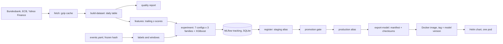

# Financial market anomaly detection with an MLOps lifecycle

A system that detects stress in German and euro-area financial time series after it has begun.
It is built around the lifecycle of the model: real data ingestion, leakage-safe features, three
model families compared under a fixed protocol, experiment tracking, a model registry with a
scripted promotion gate, explanations, a containerised API and a Helm chart.

It is not a forecasting or trading tool. It does not predict crashes. Its alarms flag days that
look unusual relative to the preceding year, and its validation shows how many curated stress events
it flagged and how quickly. This is not financial advice.

## Summary

Generated from `results/` by `finanomaly report`.

<!-- BEGIN:headline -->
* Data: 7057 DAX trading days from 1999-01-04 to 2026-10-16, Bundesbank, ECB and Yahoo Finance sources.
* 15 curated, sourced stress events (frozen before modelling).
* Promoted model: **anomaly-isolation-forest** version 1 (validation event recall 1.000, 2.49 false alarm episodes per year).
* Test period, rule_return: 4 of 6 events detected, 2.83 alarm episodes per year outside the event list.
* Test period, rule_vol: 2 of 6 events detected, 0.42 alarm episodes per year outside the event list.
* Test period, anomaly-isolation-forest (champion): 6 of 6 events detected, 4.24 alarm episodes per year outside the event list.
* Test period, anomaly-autoencoder: 5 of 6 events detected, 4.10 alarm episodes per year outside the event list.
* Test period, anomaly-lightgbm: 5 of 6 events detected, 1.41 alarm episodes per year outside the event list.
<!-- END:headline -->

Read `docs/WALKTHROUGH.md` for a reading order and a re-implementation order, `docs/ARCHITECTURE.md`
for the diagrams, `docs/MODEL_CARD.md` for the promoted model, `docs/PROMOTION_DECISION.md` for the
gate output, and `docs/EVALUATION_PROTOCOL.md` for the pre-registered protocol.

## Architecture and lifecycle



## Quick start

Python 3.11 or newer. On Windows use the PowerShell forms; every command is the `finanomaly` CLI.

```bash
python -m venv .venv
.venv/Scripts/activate            # Linux/macOS: source .venv/bin/activate
pip install --extra-index-url https://download.pytorch.org/whl/cpu -r requirements-dev.txt
pip install -e .
finanomaly fetch && finanomaly build-dataset && finanomaly quality
finanomaly events-freeze && finanomaly eda && finanomaly baselines
finanomaly experiment --family all        # resumable, about a minute
finanomaly register && finanomaly promote
finanomaly evaluate && finanomaly review && finanomaly explain
finanomaly export-model && finanomaly serve-api
```

Then `python deploy/minikube/smoke_test.py http://127.0.0.1:8000`. The test suite runs with
`pytest --cov --cov-fail-under=80`; tests that need the cached data skip with a message when
`finanomaly fetch` has not been run. `scripts/e2e.ps1` (or `.sh`) runs refresh, export, serve and
smoke test in one go.

## Data

All sources are free and need no account. Raw responses are cached gzip-compressed under
`data/raw/` and are never committed.

<!-- BEGIN:catalog -->
| Series | Source | Flow | Key | First | Last | Observations |
|---|---|---|---|---|---|---|
| usd_per_eur | Bundesbank | BBEX3 | `D.USD.EUR.BB.AC.000` | 1999-01-04 | 2026-10-16 | 7116 |
| chf_per_eur | Bundesbank | BBEX3 | `D.CHF.EUR.BB.AC.000` | 1999-01-04 | 2026-10-16 | 7116 |
| gbp_per_eur | Bundesbank | BBEX3 | `D.GBP.EUR.BB.AC.000` | 1999-01-04 | 2026-10-16 | 7116 |
| jpy_per_eur | Bundesbank | BBEX3 | `D.JPY.EUR.BB.AC.000` | 1999-01-04 | 2026-10-16 | 7116 |
| de_yield_2y | Bundesbank | BBSIS | `D.I.ZST.ZI.EUR.S1311.B.A604.R02XX.R.A.A._Z._Z.A` | 1999-01-04 | 2026-10-16 | 7060 |
| de_yield_10y | Bundesbank | BBSIS | `D.I.ZST.ZI.EUR.S1311.B.A604.R10XX.R.A.A._Z._Z.A` | 1999-01-04 | 2026-10-16 | 7060 |
| ecb_mro | ECB | FM | `D.U2.EUR.4F.KR.MRR_FR.LEV` | 1999-01-01 | 2026-10-17 | 7121 |
| ecb_dfr | ECB | FM | `D.U2.EUR.4F.KR.DFR.LEV` | 1999-01-01 | 2026-10-17 | 10152 |
| ecb_mlf | ECB | FM | `D.U2.EUR.4F.KR.MLFR.LEV` | 1999-01-01 | 2026-10-17 | 10152 |
| dax_close | Yahoo Finance via yfinance | nan | `^GDAXI` | 1999-01-04 | 2026-10-16 | 7057 |
<!-- END:catalog -->

* **Bundesbank** SDMX web service (`https://api.statistiken.bundesbank.de/rest`): euro reference
  exchange rates (BBEX3) and the Svensson term structure of listed federal securities (BBSIS).
  The Bundesbank's reuse terms for ESCB statistics require the source to be quoted and the
  statistics not to be modified
  ([terms](https://www.bundesbank.de/en/homepage/user-information/terms-of-use-regarding-the-reuse-of-escb-statistics-621188)).
  Source: Deutsche Bundesbank. The Bundesbank has announced that its legacy time series database
  closes on 30 June 2026; the SDMX service was still answering when the data for this repository was
  fetched.
* **ECB Data Portal** (`https://data-api.ecb.europa.eu/service/data`): key interest rates
  (dataflow FM). The ECB's copyright notice allows free use if the ECB is cited as the source and
  changes to the data are stated
  ([terms](https://www.ecb.europa.eu/services/disclaimer/html/index.en.html)). Source: ECB.
* **DAX index** (`^GDAXI`) through `yfinance`, an unofficial client for Yahoo Finance data
  intended for personal and research use. The data is cached and never redistributed here. A Stooq
  fallback exists in the code and was not needed.
* The series are aligned on DAX trading days. FX and yield series are forward-filled for at most 3
  calendar days (none was needed); ECB policy rates are step functions and are carried forward.
  The quality report is `results/data_quality.json`; exploratory figures are in
  `results/figures/eda/`.

### Curated stress events

The labels and the evaluation ground truth are 15 real market stress events, each with sources and
a one-line justification in `data/events.yaml`. Onset is the first trading day of the market
reaction. The file and the window configuration are hashed in `results/events_frozen.json` before
any model was trained, and a test fails if either changes. Six events fall in the test period (2019
onward); three in validation (2015 to 2018).

<!-- BEGIN:events -->
| Id | Event | Category | Onset | Sources |
|---|---|---|---|---|
| sept11_2001 | September 11 attacks | systemic | 2001-09-11 | [1](https://money.cnn.com/2001/09/14/europe/markets_europe/), [2](https://money.cnn.com/2001/09/17/europe/markets_europe/) |
| worldcom_2002 | WorldCom bankruptcy and the July 2002 sell-off | equity | 2002-07-22 | [1](https://www.upi.com/Business_News/2002/07/22/Stocks-fall-sharply/99731027354751/), [2](https://www.bis.org/publ/qtrpdf/r_qt0209ger_a.pdf) |
| lehman_2008 | Lehman Brothers bankruptcy | systemic | 2008-09-15 | [1](https://www.nber.org/papers/w22410.pdf), [2](https://www.history.com/this-day-in-history/lehman-brothers-collapses) |
| crash_oct2008 | October 2008 global equity crash | equity | 2008-10-06 | [1](https://www.thelocal.de/20081006/14719), [2](https://www.t-online.de/finanzen/ratgeber/geldanlage/boerse/id_100670460/dax-stuerzt-ab-dunkelste-tage-des-deutschen-leitindex-im-rueckblick.html) |
| flash_crash_2010 | Flash crash and May 2010 euro area stress | equity | 2010-05-06 | [1](https://www.csmonitor.com/Money/2010/0519/SEC-unveils-flash-crash-fixes-but-Dow-plunge-still-mysterious), [2](https://www.planadviser.com/regulators-release-flash-crash-probe-report/) |
| aug2011_selloff | August 2011 US downgrade and euro crisis sell-off | systemic | 2011-08-08 | [1](https://en.wikipedia.org/wiki/August_2011_stock_markets_fall), [2](https://www.wbur.org/news/2011/08/08/stocks-tumble-downgrade) |
| snb_floor_2015 | SNB removes the EUR/CHF floor | fx | 2015-01-15 | [1](https://www.bis.org/review/r150116a.htm), [2](https://www.ft.lk/Financial-Services/switzerland-ends-euro-minimum-exchange-rate-cuts-interest-rate/42-382312) |
| china_aug2015 | China devaluation sell-off | equity | 2015-08-24 | [1](https://www.cityam.com/ftse-edges-towards-6000-after-china-shock/), [2](https://fortune.com/2015/08/24/dow-plunges-1000-points-stocks-markets) |
| brexit_2016 | Brexit referendum result | systemic | 2016-06-24 | [1](https://www.nbcnews.com/storyline/brexit-referendum/brexit-prospect-sends-pound-35-year-low-pummeling-markets-n598096), [2](https://www.ii.co.uk/analysis-commentary/stockmarkets-and-pound-plunge-black-friday-britain-votes-brexit-ii331341) |
| covid_crash_2020 | COVID-19 crash | systemic | 2020-02-24 | [1](https://www.cnbc.com/2020/02/24/european-markets-focus-on-coronavirus-spread-in-italy.html), [2](https://fox6now.com/2020/03/12/global-shares-sink-on-pandemic-news-waning-hopes-for-fix/) |
| ukraine_invasion_2022 | Russian invasion of Ukraine | systemic | 2022-02-24 | [1](https://www.business-standard.com/amp/article/international/european-stocks-in-correction-territory-after-russia-attacks-ukraine-122022400743_1.html), [2](https://gna.org.gh/2022/02/world-markets-dive-oil-soars-as-russia-invades-ukraine/) |
| ecb_hike_2022 | First ECB rate hike of the 2022 cycle | rates | 2022-07-21 | [1](https://www.fxstreet.com/amp/news/breaking-ecb-hikes-key-rates-by-50-basis-points-in-july-202207211216), [2](https://schulung.table.media/en/europe/news/ecb-raises-interest-rates-surprisingly-sharply) |
| svb_credit_suisse_2023 | Silicon Valley Bank failure and Credit Suisse turmoil | systemic | 2023-03-10 | [1](https://www.euronews.com/2023/03/15/european-banks-plunge-in-the-stock-market-dragged-down-by-credit-suisse), [2](https://www.kitco.com/news/off-the-wire/2023-03-15/credit-suisse-leads-europe-bank-stock-rout-after-short-lived-svb) |
| carry_unwind_2024 | August 2024 yen carry trade unwind sell-off | fx | 2024-08-05 | [1](https://www.nbcnewyork.com/news/business/money-report/investors-are-unwinding-the-biggest-carry-trade-the-world-has-ever-seen-socgen-strategist-says/5671777/), [2](https://www.atalayar.com/en/articulo/economy-and-business/uncertainty-over-the-us-economy-and-the-yen-to-blame-for-global-stock-markets-black-monday/20240806111804203876.html) |
| tariff_shock_2025 | April 2025 tariff shock | systemic | 2025-04-03 | [1](https://stock3.com/news/liberation-day-handelsaengste-belasten-den-dax-16258502), [2](https://www.pennmutualam.com/market-insights/blogs/monday-morning-perspectives/2025-04-07-markets-likely-to-continue-to-reel-from-liberation-day-tariffs) |
<!-- END:events -->

## Method

* **Features** (`src/finanomaly/features.py`): log returns of DAX and EUR/USD, EUR/CHF, EUR/GBP,
  USD/JPY (via EUR); daily changes in the 2 and 10 year German yields and their spread; ECB deposit
  rate level and change; 5, 20 and 60 day realised volatility and the 5 to 60 day ratio; drawdown
  from the trailing 252 day maximum; 60 day DAX to EUR/USD return correlation. Model inputs are the
  trailing 252 day median/MAD z-scores of these 16 features, clipped at 10, with statistics from the
  252 days before day t only.
* **Leakage controls**: a test recomputes the features on data truncated at day t and requires
  identical values; another perturbs future prices and requires unchanged past features; the
  supervised model sees only events with onset before its cut-off; selection code never references
  the test segment (a test greps for it).
* **Labels and alarms**: label window = onset plus 9 trading days; detection window = 2 days
  before to 20 days after onset; buffer = 10 days after the detection window. An alarm is a score
  above a threshold set on pre-2019 non-event days to a budget of 3 false alarm episodes per year
  (and at most 5 percent alarm days). Consecutive alarm days merge into episodes (gap under 3 days).
  An event is detected if an alarm falls in its detection window. Alarms outside the curated list
  are not necessarily errors, because the list is incomplete.
* **Models**: Isolation Forest, a PyTorch autoencoder (score = reconstruction error, early stopping
  on non-event days), LightGBM trained on the label windows with Platt calibration, an XGBoost
  comparison group, and two rule baselines (robust return threshold and a volatility percentile).
  Seven fixed configurations per family are in `configs/experiments.yaml`.

## Results

### Validation (fit before 2015, evaluated on 2015 to 2018, three events)

<!-- BEGIN:validation -->
| Family | Config | Val recall | Val FA/yr | Val AP | Val ROC AUC | Separation |
|---|---|---|---|---|---|---|
| autoencoder | 0 | 0.667 | 2.76 | 0.175 | 0.775 | 0.66 |
| autoencoder | 1 | 0.667 | 2.76 | 0.223 | 0.773 | 0.73 |
| autoencoder | 2 | 0.667 | 2.76 | 0.205 | 0.861 | 1.06 |
| autoencoder | 3 | 0.667 | 2.76 | 0.212 | 0.874 | 1.06 |
| autoencoder | 4 | 0.667 | 2.76 | 0.218 | 0.842 | 0.83 |
| autoencoder | 5 | 0.667 | 2.76 | 0.254 | 0.853 | 0.94 |
| autoencoder | 6 | 0.667 | 2.76 | 0.104 | 0.707 | 0.48 |
| isolation_forest | 0 | 1.000 | 2.76 | 0.221 | 0.872 | 1.41 |
| isolation_forest | 1 | 1.000 | 2.76 | 0.256 | 0.880 | 1.48 |
| isolation_forest | 2 | 1.000 | 2.76 | 0.305 | 0.885 | 1.55 |
| isolation_forest | 3 | 1.000 | 2.76 | 0.228 | 0.865 | 1.35 |
| isolation_forest | 4 | 1.000 | 2.49 | 0.253 | 0.865 | 1.30 |
| isolation_forest | 5 | 1.000 | 2.76 | 0.238 | 0.868 | 1.44 |
| isolation_forest | 6 | 1.000 | 2.76 | 0.257 | 0.862 | 1.27 |
| lightgbm | 0 | 1.000 | 2.76 | 0.224 | 0.837 | 0.97 |
| lightgbm | 1 | 1.000 | 2.76 | 0.320 | 0.745 | 0.93 |
| lightgbm | 2 | 1.000 | 2.49 | 0.209 | 0.898 | 1.04 |
| lightgbm | 3 | 0.667 | 2.49 | 0.317 | 0.811 | 0.99 |
| lightgbm | 4 | 0.667 | 2.49 | 0.300 | 0.830 | 1.07 |
| lightgbm | 5 | 1.000 | 2.76 | 0.368 | 0.810 | 0.98 |
| lightgbm | 6 | 1.000 | 2.49 | 0.181 | 0.831 | 1.00 |
| xgboost | 0 | 1.000 | 2.76 | 0.381 | 0.862 | 1.07 |
| xgboost | 1 | 1.000 | 2.49 | 0.374 | 0.889 | 0.95 |
| xgboost | 2 | 1.000 | 2.76 | 0.397 | 0.880 | 1.16 |
| xgboost | 3 | 1.000 | 2.76 | 0.368 | 0.864 | 0.93 |
| xgboost | 4 | 1.000 | 2.76 | 0.425 | 0.926 | 0.99 |
| xgboost | 5 | 1.000 | 2.76 | 0.407 | 0.920 | 0.92 |
| xgboost | 6 | 1.000 | 2.76 | 0.367 | 0.909 | 1.21 |
| rule_return | rule | 0.667 | 2.76 | 0.118 | 0.676 | 0.63 |
| rule_vol | rule | 1.000 | 1.66 | 0.464 | 0.960 | 2.43 |
<!-- END:validation -->

### Promotion decision

See `docs/PROMOTION_DECISION.md`, generated by `finanomaly promote` from the logged numbers. The
test-period section of that document was added after the decision.

### Test period (2019 to the end of the data, six events, examined after the decision)

<!-- BEGIN:test -->
| Event | rule_return | rule_vol | anomaly-isolation-forest (champion) | anomaly-autoencoder | anomaly-lightgbm |
|---|---|---|---|---|---|
| covid_crash_2020 | day +0 | day +1 | day +0 | day +10 | day +0 |
| ukraine_invasion_2022 | day +0 | missed | day +0 | day +0 | day +0 |
| ecb_hike_2022 | missed | missed | day +9 | day +4 | missed |
| svb_credit_suisse_2023 | missed | missed | day +1 | day +1 | day +1 |
| carry_unwind_2024 | day -2 | missed | day -1 | missed | day -2 |
| tariff_shock_2025 | day +0 | day +1 | day +0 | day +2 | day -2 |

Delay is in trading days from onset to the first alarm in the detection window.

| Entry | Detected | Recall | FA episodes/yr | AP | ROC AUC |
|---|---|---|---|---|---|
| rule_return | 4 of 6 | 0.667 | 2.83 | 0.149 | 0.674 |
| rule_vol | 2 of 6 | 0.333 | 0.42 | 0.149 | 0.802 |
| anomaly-isolation-forest (champion) | 6 of 6 | 1.000 | 4.24 | 0.217 | 0.878 |
| anomaly-autoencoder | 5 of 6 | 0.833 | 4.10 | 0.115 | 0.828 |
| anomaly-lightgbm | 5 of 6 | 0.833 | 1.41 | 0.233 | 0.855 |
<!-- END:test -->

The per-event rows matter more than the aggregates because there are only six test events.

### Seed spread and configuration rank stability

<!-- BEGIN:seeds -->
| Family | Val recall mean (std) | Test recall mean (std) | Test FA/yr mean (std) | Test AP mean (std) |
|---|---|---|---|---|
| isolation_forest | 1.000 (0.000) | 1.000 (0.000) | 4.12 (0.35) | 0.224 (0.005) |
| autoencoder | 0.667 (0.000) | 0.900 (0.082) | 4.89 (0.76) | 0.118 (0.016) |
| lightgbm | 0.933 (0.133) | 0.967 (0.067) | 2.49 (1.08) | 0.267 (0.039) |

Spearman rank correlation of the 7 configurations, validation versus test:

| Family | AP | Event recall |
|---|---|---|
| autoencoder | 0.43 | n/a |
| isolation_forest | -0.14 | n/a |
| lightgbm | 0.86 | 0.49 |
<!-- END:seeds -->

Differences smaller than the seed spread are not claimed.

### Alarms outside the curated event list

`docs/FALSE_ALARM_REVIEW.md` lists the 20 highest-scoring alarm episodes of the champion in the
test period that are not in the event list, with what was found about each from cited sources, and
says where no source was found.

### Robustness and cross-checks

<!-- BEGIN:extra -->
Not yet run.
<!-- END:extra -->

## Explainability

Plots are in `results/explain/`. These describe model behaviour, not the causes of market moves.
For the tree models SHAP `TreeExplainer` values are in margin space; the autoencoder explanation is
each feature's share of the squared reconstruction error; for the Isolation Forest the table shows
the drop in test average precision when one feature is shuffled.

<!-- BEGIN:explain -->
| Check | LightGBM | XGBoost |
|---|---|---|
| Max SHAP additivity gap | 1.78e-15 | 3.34e-06 |
| Spearman of mean abs SHAP vs gain importance | 0.82 | 0.44 |
| Top 3 features by SHAP | vol20, r_jpy, vol_ratio | vol20, vol_ratio, corr60 |
| Top 3 features by gain | vol20, r_jpy, d_spread | vol20, vol5, r_jpy |

Isolation forest permutation sensitivity (test AP 0.217), largest AP drops:

| Feature | AP drop mean | std |
|---|---|---|
| vol_ratio | 0.014 | 0.002 |
| vol5 | 0.012 | 0.007 |
| policy_rate | 0.010 | 0.002 |
| r_dax | 0.009 | 0.004 |
| corr60 | 0.007 | 0.002 |
<!-- END:explain -->

## MLOps

* **Tracking**: every configuration is an MLflow run named `<family>-cfg<i>-seed<s>-val`, so a
  rerun skips finished runs. Experiments are `anomaly/<family>`. Runs log parameters, validation
  metrics, per-event delays, plots, the configuration files, the model with signature and input
  example, and tags for family, seed, data hash, events hash, dataset period and git commit. The
  summary is `results/runs_summary.csv`.
* **Registry**: the best configuration of each family is refit on all pre-2019 data and registered
  as `anomaly-isolation-forest`, `anomaly-autoencoder` or `anomaly-lightgbm`. MLflow 3 replaced
  registry stages with aliases, so `staging` and `production` are aliases (plus a `lifecycle` tag).
* **Promotion gate** (`experiments/promotion.py`, unit tested): validation recall at least that of
  the current production model or the best rule baseline, false alarm rate within the budget, seed
  spread of recall at most 0.2, explanations available, and the serving contract test passing.
* **Reproducibility**: the same command and seed reproduce the logged metrics (a test reruns a
  configuration and compares scores exactly). Versions are pinned in `requirements.txt`.

## Deployment

* **Docker**: `docker/Dockerfile.api` is multi-stage, CPU only, non-root (uid 10001), with the
  exported model baked into the image and a health check. Build it with `scripts/build_image.ps1`;
  the image tag equals the model version. `docker/docker-compose.yml` runs MLflow (with a volume),
  the API and a one-shot trainer profile. The MLflow server needs about 1.6 GiB of memory in this
  version, so the compose limit is 2 GiB.
* **Helm** (`deploy/helm/anomaly-api`): one Deployment with one replica, a Service, a ConfigMap,
  an optional Secret for the API key, liveness and readiness probes, resource requests and limits,
  a non-root read-only security context. No Ingress, HPA or volume.
* **Minikube**: `deploy/minikube/up.ps1` and `down.ps1`. See `results/deploy_log.md` for what was
  and was not run on this machine.

This is a single-pod demonstration on a local cluster, not a production cluster. A real one would
add replicas and autoscaling, an ingress with authentication, a managed image registry, proper
secrets handling and a scheduled refresh job.

## Limitations

* Few labelled events (3 validation, 6 test), so statistical power is low and per-event results
  matter more than averages; configuration ranking rests on tie-breaks.
* The event list is curated and incomplete, so alarms outside it are not necessarily errors.
* Labels are coarse windows; average precision and ROC AUC on daily labels are rough measures.
* The system detects stress after onset. It is not a forecasting or trading tool.
* Daily data only; the DAX series comes from an unofficial source.
* The models are trained on one market regime history; the alarm threshold set on 2015 to 2018 did
  not transfer exactly to the test period (see the false alarm rates above).
* Results come from one machine (Windows 11, 8 logical CPUs, 6.9 GiB RAM, CPU only).
* The Kubernetes deployment is a single-pod local demonstration.

## Reproduction

1. Clone, create the environment and install (Quick start). 2. `finanomaly fetch` downloads and
caches the data (a few minutes). 3. Run the commands in order; hashes in `results/` identify the
data and event versions. Randomness uses seed 0; the multi-seed study uses seeds 0 to 4.

## References

* Bundesbank statistics portal and SDMX service: https://api.statistiken.bundesbank.de/rest
* ECB Data Portal: https://data-api.ecb.europa.eu
* Liu, Ting and Zhou (2008), Isolation Forest, ICDM. Ke et al. (2017), LightGBM, NeurIPS.
  Lundberg and Lee (2017), SHAP, NeurIPS; Lundberg et al. (2020), TreeExplainer, Nature Machine
  Intelligence.
* Event sources are listed per event in `data/events.yaml`.
