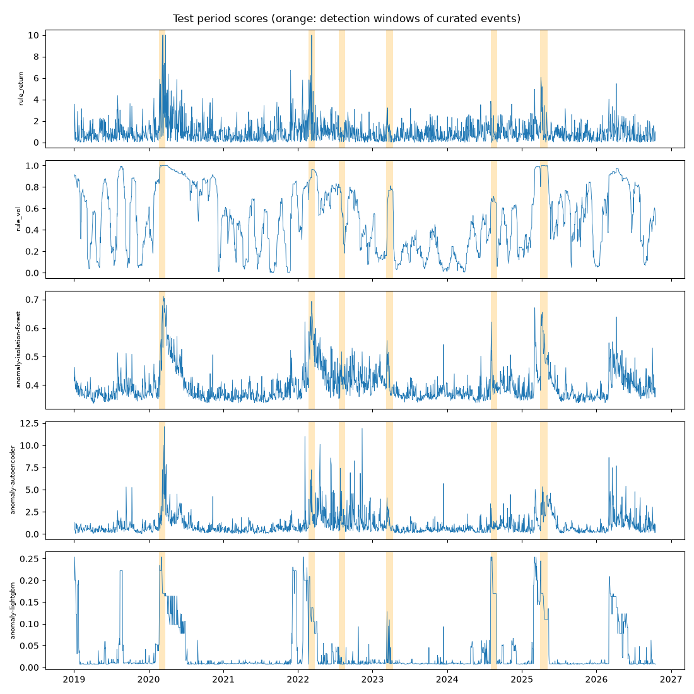
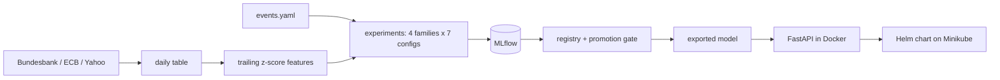

# Financial anomaly detection (DAX, FX, Bund yields)

I wanted a project where the model is the small part and everything around it is the real work:
getting data, tracking experiments, deciding which model gets deployed, packaging it, and running
it behind an API on Kubernetes. The model itself flags trading days on which German and euro-area
markets look unusual compared with the previous year.

It does not predict crashes and it is not a trading tool. It notices stress after it has started,
and the evaluation asks how many known stress events it caught and how fast.



## What is in here

- **Data**: daily DAX closes (Yahoo Finance), EUR exchange rates and German 2y/10y yields
  (Bundesbank), ECB policy rates. All free, no account needed. 7,057 trading days from 1999 to
  October 2026.
- **Ground truth**: 15 stress events that I collected with sources (Lehman, Brexit vote, COVID
  crash, SNB floor removal, ...). They live in `data/events.yaml` and were frozen with a hash
  before I trained anything.
- **Features**: returns, yield changes, realised volatility, drawdown and a DAX/EURUSD
  correlation, all turned into z-scores against the previous 252 days. Nothing uses future data,
  and there are tests that check exactly that.
- **Models**: Isolation Forest, a small PyTorch autoencoder, LightGBM (plus XGBoost as a
  comparison), and two simple rule baselines.
- **MLOps**: every run is logged to MLflow, the best config per family goes to the model registry,
  and a scripted promotion gate decides what becomes `production`.
- **Serving**: FastAPI service, Docker image, Helm chart, tested on a local Minikube cluster.



## Results

Time split: models are fit on data before 2015, compared on 2015 to 2018 (3 events), and the
winner is checked once on 2019 onward (6 events). An event counts as detected if an alarm fires
between 2 days before and 20 days after its onset. Thresholds are set so that a model raises about
3 false alarm episodes per year on the validation years.

Test period:

| Model | Events detected | False alarm episodes / year | Share of days in alarm |
|---|---|---|---|
| Return rule (baseline) | 4 of 6 | 2.83 | 2.5% |
| Volatility rule (baseline) | 2 of 6 | 0.42 | 4.9% |
| **Isolation Forest (promoted)** | **6 of 6** | 4.24 | 8.3% |
| Autoencoder | 5 of 6 | 4.10 | 4.3% |
| LightGBM | 5 of 6 | 1.41 | 14.3% |

The Isolation Forest won the promotion gate and caught all six test events, five of them within
two days of onset.

The honest reading is less flattering. Six events is very little, and the Isolation Forest also
alarms on more days than the return rule. When I gave every model the same share of alarm days,
the simple return rule was just as good at fast detection. So the takeaway is not "ML beats
rules" but that the pipeline around the model works and makes this kind of comparison easy to
run and hard to fool yourself with. All tables, including the chance-level check, leave-one-event-out,
sensitivity and ablation runs, are in [docs/RESULTS.md](docs/RESULTS.md).

## Running it

Python 3.11+.

```bash
python -m venv .venv
source .venv/bin/activate          # Windows: .venv\Scripts\activate
pip install --extra-index-url https://download.pytorch.org/whl/cpu -r requirements-dev.txt
pip install -e .
```

Everything goes through one CLI, in this order:

```bash
finanomaly fetch            # download and cache the raw series
finanomaly build-dataset    # one aligned daily table
finanomaly quality          # sanity checks on the table
finanomaly events-freeze    # hash the event list
finanomaly experiment --family all   # 28 MLflow runs, about two minutes on a laptop
finanomaly register         # best config per family -> registry, alias "staging"
finanomaly promote          # promotion gate -> alias "production"
finanomaly evaluate         # test period, only after the decision
finanomaly explain          # SHAP and friends
finanomaly export-model     # self-contained model folder with checksums
finanomaly serve-api        # http://127.0.0.1:8000/docs
```

`mlflow ui --backend-store-uri sqlite:///mlflow.db` shows the runs and the registry.

Tests: `pytest`. Tests that need the downloaded data skip themselves if you have not run `fetch`.

### Docker and Kubernetes

```bash
scripts/build_image.sh                                   # image tag = model version
docker compose -f docker/docker-compose.yml up -d mlflow api
deploy/minikube/up.sh                                    # Helm install on Minikube + smoke test
deploy/minikube/down.sh
```

There are PowerShell versions of the scripts next to the shell ones (I built this on Windows).
The Helm chart is one Deployment with one replica, a Service, a ConfigMap and an optional API key
Secret. It is a local single-pod demo, not a production cluster.

## Layout

```
src/finanomaly/
  data/          fetchers, dataset build, quality checks
  features.py    leakage-safe features
  events.py      event windows and labels
  models/        rules, isolation forest, autoencoder, gradient boosted trees
  experiments/   run configs, MLflow tracking, registry, promotion gate
  evaluation/    alarm episodes, metrics, test evaluation, robustness checks
  explain/       SHAP, reconstruction shares, permutation checks
  serving/       model export, loading and scoring
api/             FastAPI app
deploy/          Helm chart and Minikube scripts
docker/          Dockerfiles and compose file
```

More detail: [architecture](docs/ARCHITECTURE.md), [evaluation protocol](docs/EVALUATION_PROTOCOL.md),
[promotion decision](docs/PROMOTION_DECISION.md), [model card](docs/MODEL_CARD.md),
[review of false alarms](docs/FALSE_ALARM_REVIEW.md), [known issues](docs/KNOWN_ISSUES.md).

## Limitations

- Only 3 validation and 6 test events, so the numbers are coarse and model selection came down to
  tie-breaks.
- My event list is incomplete, so an alarm outside it is not automatically wrong.
- The false alarm threshold drifted: tuned for 3 episodes per year, the promoted model produced
  about 4 on the test years.
- Daily data only, and the DAX series comes from an unofficial Yahoo Finance client.
- Everything was run on one laptop (Windows 11, CPU only).

## Data sources

Deutsche Bundesbank (SDMX web service), European Central Bank (ECB Data Portal) and Yahoo Finance
via `yfinance`. Raw downloads are cached locally and not redistributed here. This is a learning
project, not financial advice.
