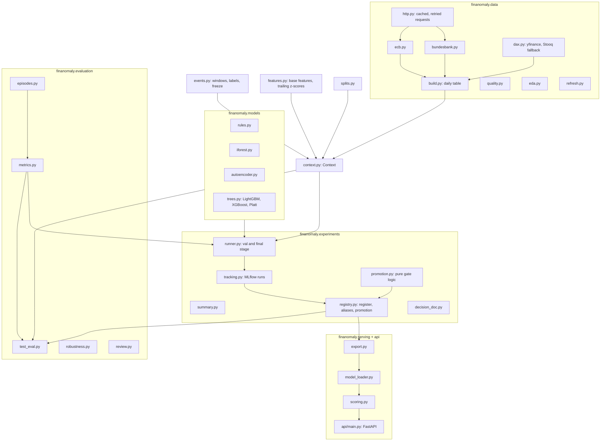
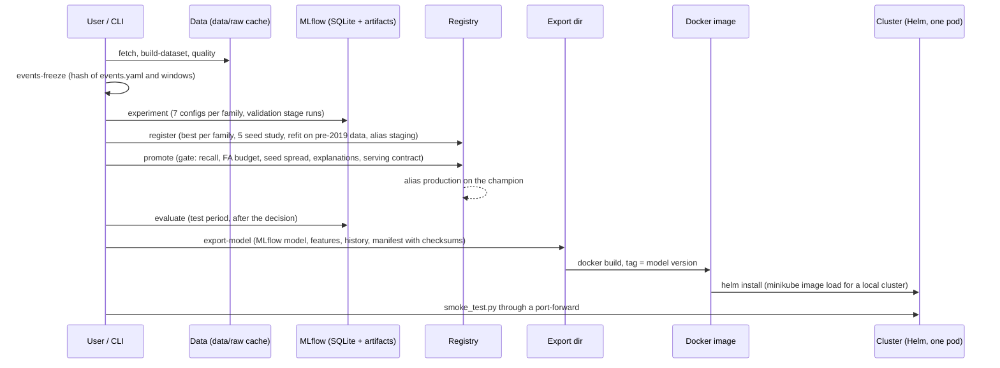
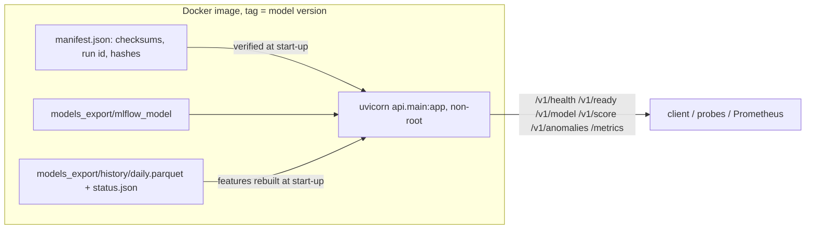

# Architecture

Everything below matches the code in `src/finanomaly`, `api/`, `docker/` and `deploy/`.

## Module map

## Lifecycle: data to cluster

## Training stages and what each may see

| Stage | Fit data | Threshold calibration | Evaluated on | Used for |
|---|---|---|---|---|
| Validation stage | before 2015 (supervised: events with onset before 2015) | non-event days of 2015 to 2018 | 2015 to 2018 | configuration selection, gate |
| Final stage | all data before 2019 | unsupervised: non-event days of 2015 to 2018 (in sample); supervised: validation stage probability threshold | test period (2019 onward), after the decision | registered model, test numbers |

## Serving

The API refuses to load when the manifest is missing or the checksums do not match, answers
`/v1/health` regardless, and reports `ready: false` (HTTP 503) until a model is loaded. The refresh job
(`finanomaly refresh`) publishes new data only when the quality checks pass; otherwise it records
`quality_ok: false` in `history/status.json` and the API marks scores as stale.

## Kubernetes objects (Helm chart `deploy/helm/anomaly-api`)

One Deployment (one replica, non-root, read-only root filesystem, probes on `/v1/health` and
`/v1/ready`), one ClusterIP Service, one ConfigMap, and an optional Secret for the API key. No
Ingress, autoscaler or persistent volume.
